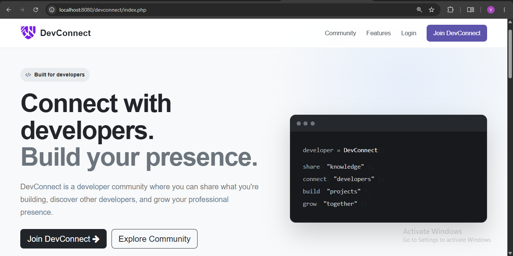
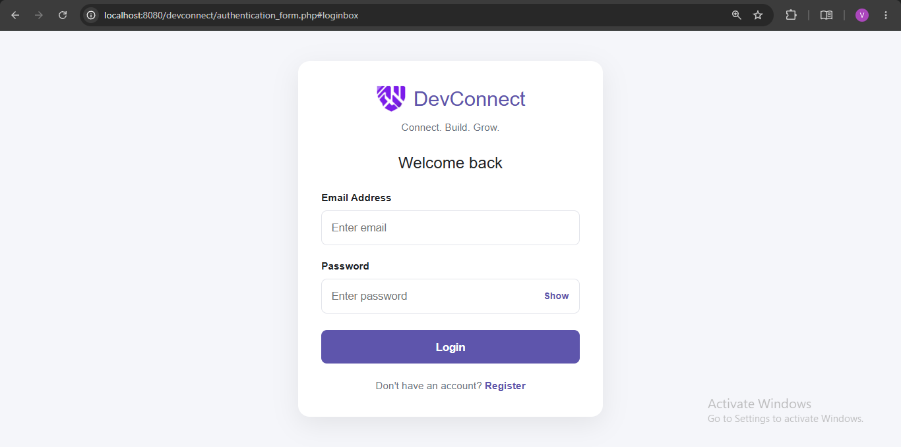
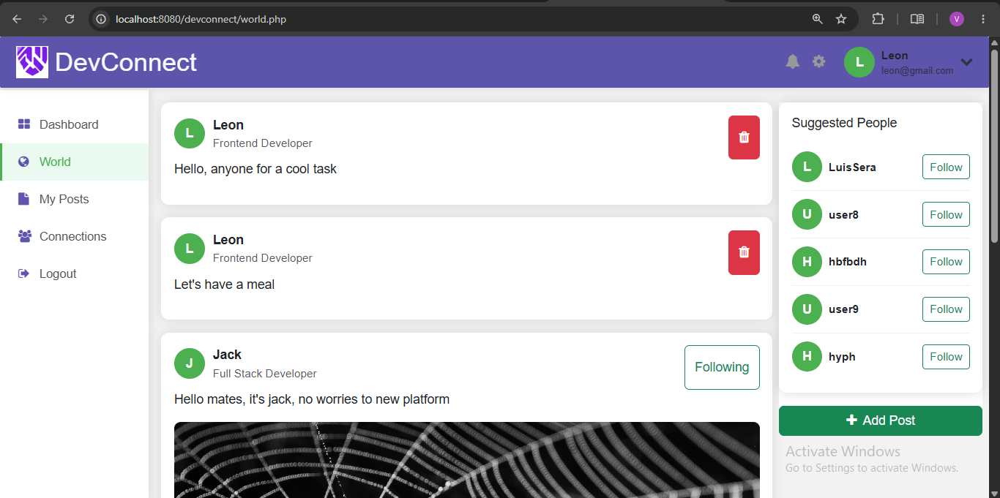
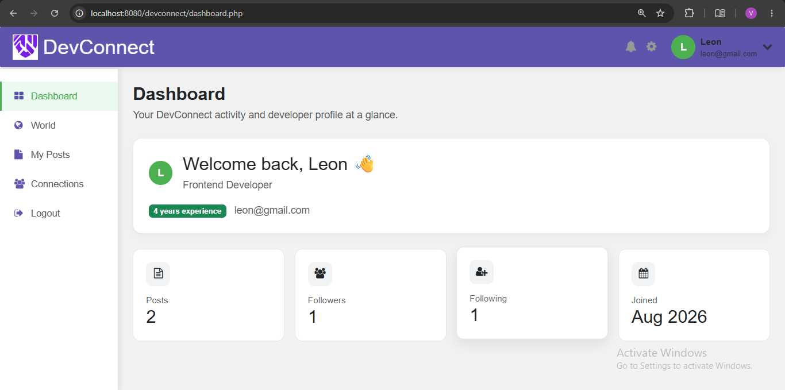

# DevConnect

DevConnect is a developer community web application built with PHP, MySQL, JavaScript, and Bootstrap. Users can create accounts, share posts, discover other developers, and follow their profiles.

## 🌐 Live Demo

**Try DevConnect:** https://devconnect.infinityfree.io/

Explore the live application and its developer community features.

**Project type:** Portfolio project

## Features

- User registration, login, and logout
- Password hashing using PHP's password-hashing functions
- MySQL database integration using MySQLi and prepared statements
- Developer profiles with developer roles and experience information
- Text posts with optional image uploads
- A world feed for browsing posts
- Follow and unfollow functionality
- Follower and following connections
- Responsive interface built with Bootstrap and custom CSS
- CSRF protection for supported actions and output escaping for displayed user content
- **Mobile-Friendly Navigation:** Responsive sidebar navigation and an adapted World feed layout for smaller screens.

## Tech stack

- **Frontend:** HTML5, CSS3, JavaScript, Bootstrap 5, Font Awesome
- **Backend:** PHP
- **Database:** MySQL/MariaDB
- **Database access:** PHP MySQLi
- **Dependencies and environment configuration:** Composer and `vlucas/phpdotenv`
- **Local development:** XAMPP
- **Version control:** Git and GitHub

## Screenshots

### Index Page


### Login and Registration


### World Feed


### Dashboard



## Requirements

To run DevConnect locally, you need:

- XAMPP with Apache, PHP, and MySQL/MariaDB
- Composer
- Git, if you want to clone the repository

## Run locally

### 1. Clone the repository

git clone https://github.com/VanshJaiswalHub/devconnect.git


Place the project inside your XAMPP `htdocs` directory. For example, on Windows:

C:\xampp\htdocs\devconnect

### 2. Start Apache and MySQL

Open the XAMPP Control Panel and start Apache and MySQL.

### 3. Install dependencies

Open a terminal in the project directory and run:

composer install

### 4. Configure environment variables

Copy `.env.example` to a new file named `.env` in the project root.

On Windows PowerShell, you can run:

Copy-Item .env.example .env

Open `.env` and configure the database settings for your local environment:

DB_HOST=localhost
DB_NAME=dev_connect
DB_USER=your_database_user
DB_PASS=your_database_password

Replace the example values with the credentials for your local database. The variable names must remain consistent with the application's configuration.

**Important:** Never commit your `.env` file or publish database credentials. The repository includes `.env.example` as a template.

### 5. Database Setup

DevConnect uses MySQL to store user accounts, posts, and related application data.

1. Create a MySQL database named `dev_connect` in your local development environment.
2. Import [`database/schema.sql`](database/schema.sql) using phpMyAdmin or the MySQL command line. This file creates the database tables and their structure.
3. Optionally import [`database/seed.sql`](database/seed.sql) to populate the tables with sample data for testing and development.
4. Configure your database credentials in your local `.env` file using the variable names provided in `.env.example`.

**Note:** The seed file is optional. Review its contents before importing, especially if you have already populated your database.

### 6. Open DevConnect

Visit:

`http://localhost/devconnect/`

Make sure the database configuration is correct and both Apache and MySQL are running.

## Demo accounts

Email Address : 'leon@demo.dev'
Password : 'leon123'

Email Address : 'jack@demo.dev'
Password : 'jack123'

## Images and uploads

- Fixed sample images are stored in `assets/images/`.
- User-uploaded post images are stored in `assets/uploads/posts/`.
- `.gitkeep` preserves the uploads directory in Git when it contains no tracked files.

Uploaded images are runtime data. They should not be committed as part of the source code unless they are intentionally included as public sample assets.

## Security considerations

DevConnect uses password hashing and prepared statements for database operations. It also includes CSRF-related functionality and output escaping for supported actions and displayed content.

Before using a public deployment, review authentication, authorization, session handling, CSRF protection, uploaded-file validation, database error handling, and configuration security across the application. These protections should not be assumed to cover every endpoint without testing.

Do not use real personal data or personal account credentials in demo accounts.


## Project structure

```text

devconnect/
|-- assets/
|   |-- images/
|   |   `-- demo_posts/
|   |-- uploads/
|   |   `-- posts/
|   |-- script.js
|   `-- style.css
|-- components/
|   |-- sidebar.php
|   `-- topbar.php
|-- database/
|   |-- schema.sql
|   `-- seed.sql
|-- includes/
|   |-- auth_check.php
|   |-- connection.php
|   |-- csrf.php
|   `-- current_user.php
|-- screenshots/
|-- .env.example
|-- .gitignore
|-- composer.json
|-- composer.lock
|-- authentication_form.php
|-- connections.php
|-- create_post.php
|-- dashboard.php
|-- delete_post.php
|-- follow.php
|-- follow_action.php
|-- index.php
|-- login_process.php
|-- logout.php
|-- my_posts.php
|-- register_process.php
|-- world.php
`-- README.md
```

## Future improvements

- Improve validation and error handling across forms
- Add pagination and search or filtering to the feed
- Continue improving accessibility and mobile usability
- Add notification and mailing
- Add automated tests for authentication, posts, and follow actions

## Author

GitHub: [VanshJaiswalHub](https://github.com/VanshJaiswalHub)


For bugs or suggestions, open an issue in the repository.